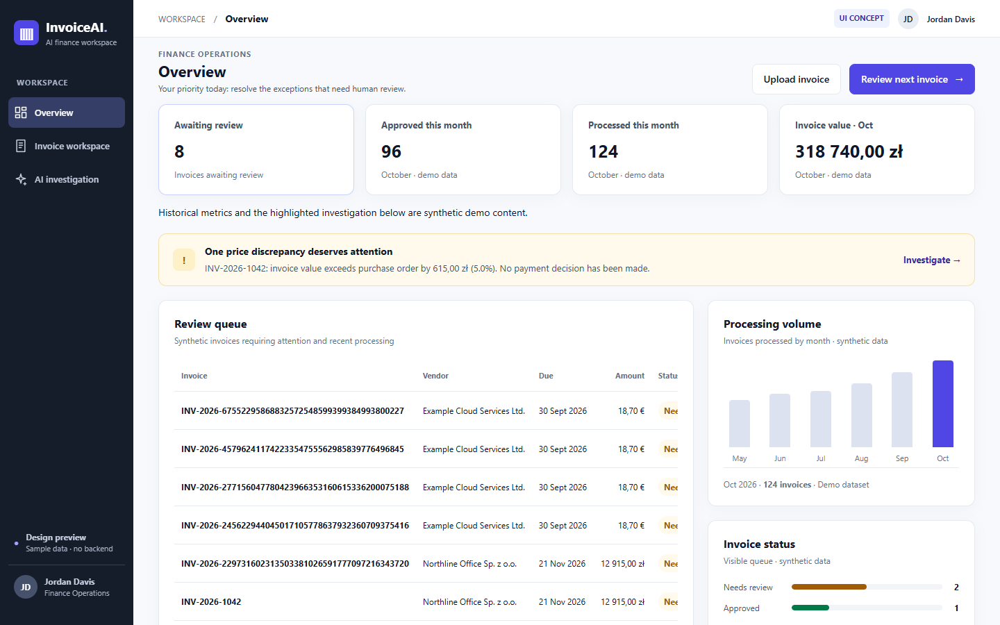
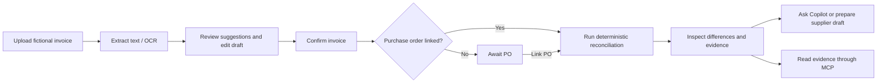
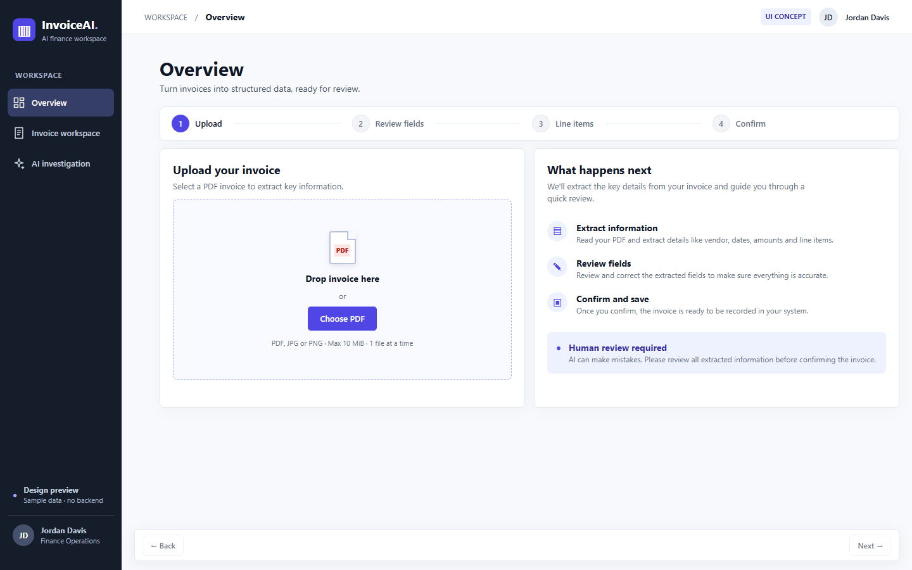
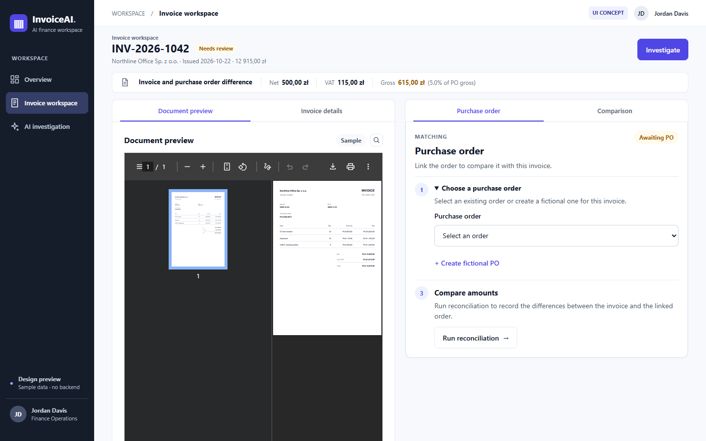
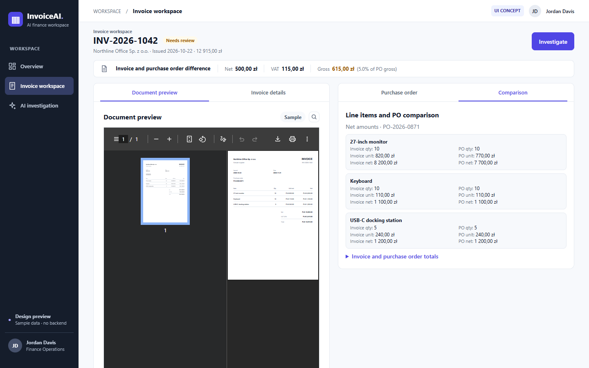
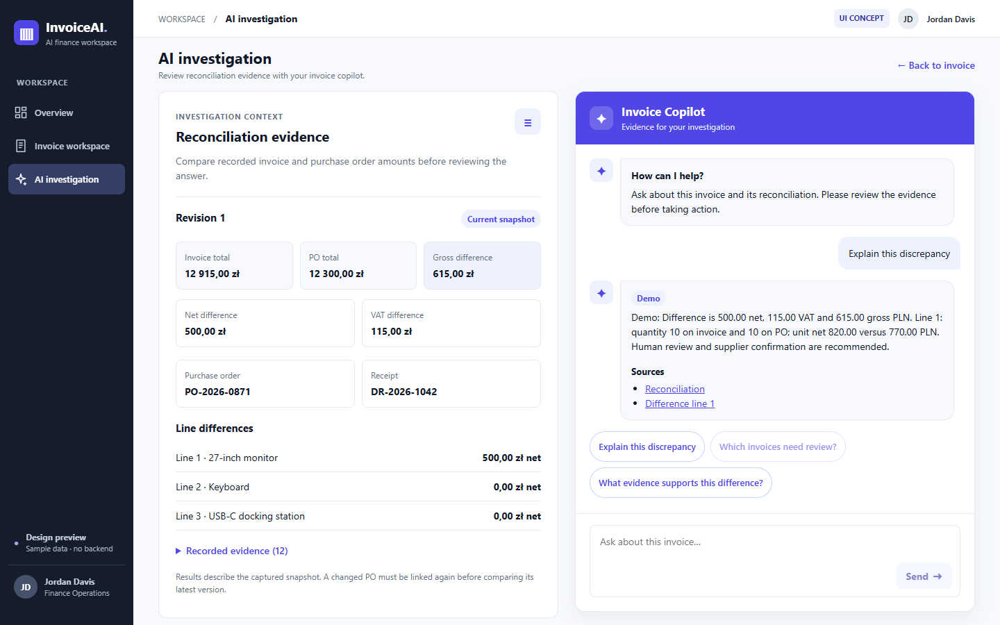
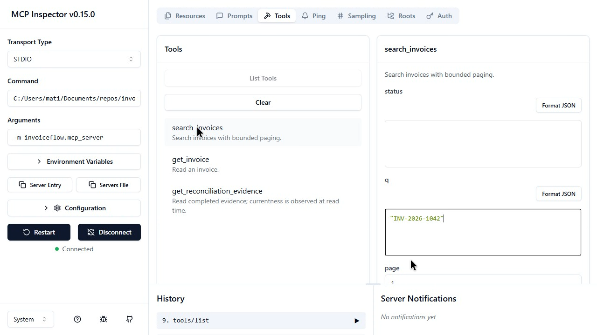
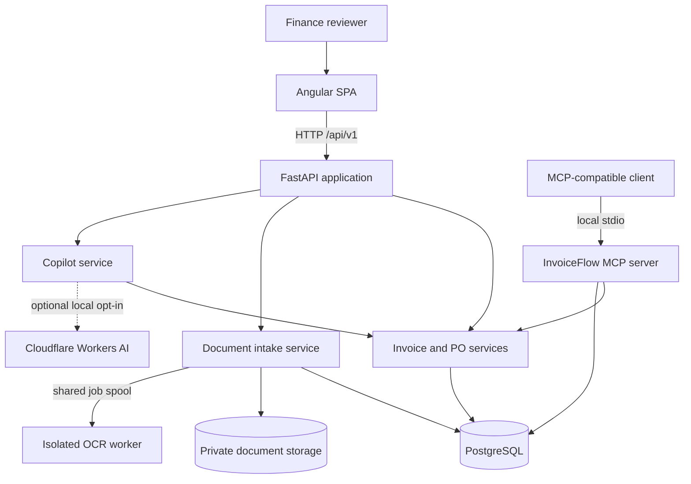
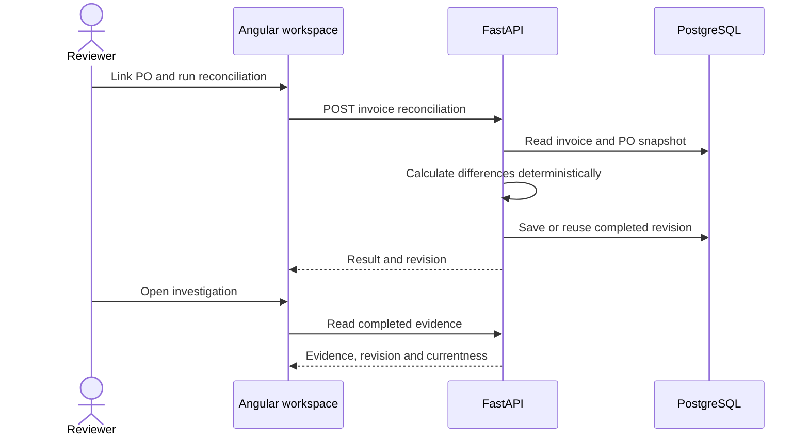

# InvoiceAI

**A local-first invoice review workspace for finance operations.** InvoiceAI brings document intake, purchase-order matching, deterministic reconciliation and evidence-backed investigation into one workflow. It is a portfolio application built with Angular, FastAPI and PostgreSQL; its sample invoices and dashboard metrics are fictional.



*Overview: open the next invoice for review, upload a document or investigate a highlighted discrepancy. Historical metrics and charts are synthetic; the review queue uses the invoice API.*

## Why InvoiceAI?

Reviewing an invoice often means switching between the source document, extracted fields, a purchase order and a separate explanation of a discrepancy. InvoiceAI brings these views together so a reviewer can:

- **Reduce manual transcription:** upload a document, extract text, review suggested fields and correct the draft before confirming it.
- **Find discrepancies faster:** link a purchase order and compare line items and totals using deterministic backend calculations.
- **Understand the evidence:** inspect a recorded reconciliation revision and ask the Copilot to explain supported findings.
- **Prepare a response:** create, edit and copy a supplier inquiry draft for human review. The application does not send it.
- **Connect an AI client:** discover and call read-only invoice tools through the local MCP server.

**Human review remains part of the workflow.** Uploading or confirming a draft does not approve or pay an invoice. The sample Copilot response shown below uses deterministic demo mode; it is not a live model response.

## Contents

- [A finance review journey](#a-finance-review-journey)
- [Product walkthrough](#product-walkthrough)
- [Architecture](#architecture)
- [Technology stack](#technology-stack)
- [Repository structure](#repository-structure)
- [Run locally](#run-locally)
- [Verify and test](#verify-and-test)
- [Scope and limitations](#scope-and-limitations)
- [Further documentation](#further-documentation)

## A finance review journey



| User | Use case | Outcome |
| --- | --- | --- |
| Finance operator | Upload a PDF or image and review suggested fields | A human-confirmed invoice record, with the source document retained locally |
| Invoice reviewer | Link a purchase order and run reconciliation | A saved comparison with line and total differences |
| Analyst | Inspect a revision and ask a question | An evidence-backed response subject to human review |
| Finance operator | Draft a supplier clarification | Editable text to review and copy; no message is sent |
| Developer or AI client | Discover and invoke MCP tools | Bounded read-only access to invoice and reconciliation data |

## Product walkthrough

### 1. Prioritize work

The Overview combines a review queue with a highlighted exception. Use **Upload invoice** to begin intake, **Review next invoice** to open a queued invoice, or **Investigate** to examine the highlighted sample. The dashboard's historical KPIs and charts are illustrative and are labelled as synthetic.


### 2. Upload and review a document

The guided intake accepts a local PDF, JPEG or PNG within the documented limits. After upload, the reviewer can extract text, request supported field suggestions, selectively apply them, correct the draft and confirm it. Digital PDF text extraction and OCR are distinct processing paths; extraction does not guarantee correct values.



*The upload screen explains the sequence: upload, review fields, review line items and confirm. Suggestions require human inspection before confirmation.*

### 3. Review invoice and purchase order

The workspace brings the source preview, invoice details and purchase-order workflow together. A reviewer can select or create a fictional PO, map its lines, run reconciliation and open the comparison. A missing PO remains an explicit state rather than a fabricated match.



*The sample invoice has a historical comparison; the PO panel also shows that an independent purchase order can be linked for subsequent reconciliation.*



*The comparison shows quantities and unit prices for each line. For the sample, the invoice gross is PLN 12,915.00 versus a PO gross of PLN 12,300.00: a PLN 615.00 difference.*

### 4. Investigate and prepare a response

The investigation view presents a recorded revision, totals, line differences and evidence references. In the Copilot panel, a reviewer can ask a supported question, follow source links and prepare a supplier inquiry draft. Demo mode produces deterministic responses; an optional, separately configured local Cloudflare provider is available for fictional data.



*The screenshot shows an actual demo-mode response, not live AI inference. Evidence and financial facts come from backend services; the user remains responsible for the decision.*

### 5. Connect through MCP

The local MCP server exposes three typed tools to compatible clients:

- `search_invoices` — search and page through invoice records.
- `get_invoice` — retrieve an invoice and its details.
- `get_reconciliation_evidence` — read a completed revision and its evidence, optionally requiring current inputs.



*The Inspector connects to the server over stdio. The following recording calls all three tools against a fictional invoice and its saved reconciliation.*

https://github.com/user-attachments/assets/bce5e541-705d-49a3-bccf-ba92f4f6eee0

See the [MCP server guide](docs/architecture/mcp-server.md) and [example client configuration](mcp-client.example.json) for setup and operational boundaries.

## Architecture

InvoiceAI is a **modular monolith**: the Angular SPA talks to a FastAPI application whose domain modules share PostgreSQL. The OCR worker is a separate process/container. The MCP server is a local adapter over the same application services.



| Boundary | Responsibility |
| --- | --- |
| Angular | Navigation, review forms, invoice workspace, evidence and Copilot interaction |
| FastAPI | HTTP contracts, validation, application services and explicit error responses |
| Invoice / PO services | Persistence, purchase-order links and authoritative reconciliation calculations |
| Intake / OCR worker | Private document intake, extraction and OCR; users review suggestions before confirmation |
| Copilot | Bounded read tools, provider orchestration and evidence validation; demo and optional live modes are distinct |
| MCP | Local read-only access to existing invoice and reconciliation services |

### Reconciliation and evidence



Amounts are derived by backend business logic rather than model arithmetic. Revisions preserve the recorded inputs and result. Evidence currentness is evaluated at read time; a later edit can make a result stale.

## Technology stack

| Layer | Technologies |
| --- | --- |
| Frontend | Angular 21, TypeScript, RxJS, SCSS, Angular Router |
| Backend | Python 3.13, FastAPI, Pydantic, SQLAlchemy, Alembic |
| Data | PostgreSQL 17, psycopg 3, private local document storage |
| Document processing | pypdf, Pillow, Poppler and Tesseract in an isolated OCR worker |
| AI / integration | Deterministic demo provider, optional Cloudflare Workers AI adapter, Python MCP SDK over stdio |
| Development and testing | Docker Compose, uv, npm, pytest, Vitest, ESLint, Ruff, generated OpenAPI types |

## Repository structure

```text
invoice-ai/
├── apps/
│   ├── frontend/
│   │   ├── src/app/
│   │   │   ├── core/             # API and shared application layout
│   │   │   ├── features/         # overview, intake and invoice features
│   │   │   └── shared/           # reusable presentation components
│   │   ├── public/               # frontend assets
│   │   └── scripts/              # architecture checks
│   └── backend/
│       ├── src/invoiceflow/
│       │   ├── core/             # settings and database setup
│       │   ├── modules/          # invoices, purchase_orders, intake, copilot
│       │   └── mcp_server/       # local MCP adapter
│       ├── alembic/              # database migrations
│       ├── tests/                # unit and PostgreSQL integration tests
│       └── Dockerfile.ocr        # isolated document worker image
├── docs/                         # architecture, ADRs, design and media
├── tasks/backend/                # scoped tasks and delivery criteria
├── compose.yaml                  # local service configuration
└── mcp-client.example.json       # example stdio client configuration
```

## Run locally

### Requirements

- Docker Desktop with Linux containers running.
- Node.js and npm for the frontend (CI uses Node 24).
- Python 3.13 and `uv` for local backend commands and seeding.

The following PowerShell commands use fictional local data. Run Compose from the repository root; the first OCR worker image build can take several minutes.

```powershell
# Repository root: create local configuration only if it does not exist.
if (-not (Test-Path apps/backend/.env)) {
    Copy-Item apps/backend/.env.example apps/backend/.env
}

docker compose --env-file apps/backend/.env up -d --build --wait postgres backend ocr-worker
docker compose --env-file apps/backend/.env exec backend alembic upgrade head
```

Seed the local PostgreSQL database explicitly, without overwriting existing invoices:

```powershell
cd apps/backend
uv sync --locked --python 3.13
$env:INVOICEFLOW_ENV = "local"
uv run python -m invoiceflow.modules.invoices.seed
cd ../..
```

Start the frontend in a second terminal:

```powershell
cd apps/frontend
npm ci
npm start
```

Open **http://localhost:4200** for the application and **http://localhost:8000/docs** for the FastAPI API explorer. The seed requires local mode and a loopback database URL; check an existing `.env` before using it. A completed reconciliation can be created through the API before opening its evidence. See [local development](docs/architecture/local-development.md) for the exact command, non-container setup, OCR details and troubleshooting.

## Verify and test

Frontend, from `apps/frontend`:

```powershell
npm run lint
npm run arch:test
npm run typecheck
npm test -- --watch=false
npm run build
```

Backend, from `apps/backend`:

```powershell
uv sync --locked
uv run ruff check .
uv run ruff format --check .
uv run pytest tests/unit
```

PostgreSQL integration tests require the **separate disposable database** ending in `_test`; follow the commands in [local development](docs/architecture/local-development.md#backend-tests-and-migration-checks). Tests do not require a live model call. API types can be regenerated from the running backend's OpenAPI schema with `npm run api:generate` in `apps/frontend`.

## Scope and limitations

- Use fictional or trusted local documents and synthetic database records. The application is not configured for public access or tenant isolation.
- OCR and field suggestions are assistive, can be incomplete or incorrect, and require human review. The offline suggestion parser supports documented formats rather than arbitrary invoices.
- Demo Copilot responses are deterministic. Optional Cloudflare inference requires explicit local configuration, credentials and attention to provider costs; it has not been demonstrated by the screenshots above.
- The local MCP server provides read-only tools for invoices and completed reconciliation evidence. Create a result through the application/API before requesting its evidence.
- The application does not send supplier messages, approve invoices or execute payments. Some UI labels and dashboard metrics remain prototype content.

## Further documentation

- [Local development, database lifecycle and troubleshooting](docs/architecture/local-development.md)
- [API and reconciliation contracts](docs/architecture/api-contract.md)
- [Document intake and OCR architecture](docs/architecture/document-intake.md)
- [MCP server and client configuration](docs/architecture/mcp-server.md)
- [AI evaluation](docs/architecture/ai-evaluation.md)
- [Architecture decisions](docs/adr/)
- [Code review and quality gates](docs/engineering/CODE_REVIEW.md)
