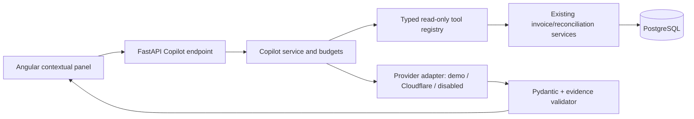

# AI Copilot — target architecture (Task 05)

**Status:** proposed contract. This document does not claim that live integration exists.

## Why AI adds value

Existing deterministic reconciliation already shows `INV-2026-1042` delta +615.00 PLN. Do not ask an LLM to recalculate it. LLM adds value only where natural-language intent spans known search and evidence endpoints, where summarizing several retrieved records reduces manual navigation, or where a human-reviewed supplier message can be drafted. For a single known invoice, a simple existing discrepancy panel may be faster and more reliable—Copilot should be an optional supplement, not replace it.

## Trust boundaries

**Hard invariant:** external model responses are untrusted. They may choose tools and propose prose, but cannot execute arbitrary queries, inspect raw document files, change financial data or grant permissions. Only existing backend services derive authoritative `Decimal` amounts.

## Tool selection and bounded loop

Three approved read-only functions: `search_invoices`, `get_invoice_details`, `get_reconciliation_evidence`. Schema-driven tool calls with Pydantic validation. Do not invent filters not supported by the current REST API. Default limits: ≤3 calls, ≤2 model rounds, ≤20 records per search, bounded question/context/answer. Enforce on server independent of model output. No production multi-turn chat history persistence for MVP.

**Responses:** `CopilotAnswer` with rendered `answer`, validated `EvidenceReference[]` citations (kind, invoice ID, optional revision/line, stable evidence ID and label), `generation_mode`, `provider`, `model`, `prompt_version`, `incomplete_context`, `human_review_required`, `suggested_questions`; `SupplierInquiryDraft` with `subject`, `body`, `draft_only=true`, evidence refs. Reconciliation tools use the planned read-only latest/by-revision service, not POST reconciliation. Current financial claims require a verified current fingerprint; historical/stale results remain readable but are labelled non-current. Reject unsupported sources, hallucinated amounts or untrusted instructions. A successful JSON parse is not enough; deterministic evidence validation is mandatory. The model never supplies navigation URLs.

## Provider & failure semantics

- `demo` = deterministic, explicitly labelled, no external API. `disabled` = explicit unavailable state. `cloudflare` = optional real inference for fictional local data only until Task 09.
- Cloudflare candidate model: `@cf/meta/llama-3.3-70b-instruct-fp8-fast` (verify docs for tool calling/JSON mode before code). REST direct from Python, never from browser. No secrets in repo.
- HTTP failures 403/429/timeout/invalid schema produce `provider_unavailable`/`invalid_ai_response` safe status. Never silently convert to demo mode and report live AI success.
- Minimize transmitted facts and logs; treat invoice text as data. Don't log private chain-of-thought; don't claim AI confidence scores are calibrated.
- Cached investigation of a **fixed reconciliation revision** can be persisted with evidence fingerprint + provider + model + prompt version; ad hoc questions need not be cached.

## Minimal user scenarios

| Question | Expected tools | Important answer quality |
|---|---|---|
| “Which invoices need review?” | `search_invoices(status=needs_review)` | Actual rows and pagination; no invented history |
| “Why INV-2026-1042?” | `get_invoice_details`, `get_reconciliation_evidence` | 615.00 PLN and correct monitor price evidence |
| “Show the vendor's last six months of issues” | Only existing search/filter | State limitation if history/time filters aren't available |
| “Write supplier inquiry” | get detail + reconciliation | Draft only, subject/body; no message sent |

## Operations & security

No public unauthenticated live inference. Use local explicit opt-in; later enforce tenant scopes across tool and result queries (Task 09). No model API in test runs. Evals are data-driven and judge selected tools, citations, numeric facts and prohibited actions. See `docs/engineering/ai-evals.md`.
