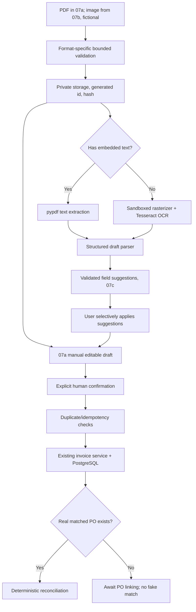

## Revised delivery flow and Task 07a contract (supersedes older sequence)

Task **07a** ships a functioning PDF-only upload (10 MiB, 20 pages, bounded structural/encryption validation), durable full-representation draft with nullable incomplete fields and revision-protected PUT, server-side validated **human confirmation creating an actual invoice**, and dynamic `Review next invoice` navigation. It requires neither OCR nor a PO. The confirmed invoice is available from existing invoice APIs and its PDF is private/retrievable through intake API. Without a real PO, show “Comparison unavailable / Awaiting PO”.

Task **07b** extends the same intake domain to validated JPEG/PNG (10 MiB, 20 decoded megapixels), reads embedded digital-PDF text and adds local Tesseract OCR for scans; **07c** maps extracted text to separate proposed fields that a user may selectively apply to the **existing 07a** editable form. Neither task re-implements confirmation. Task **07d** introduces independent POs, explicit line mappings and immutable comparison snapshots, then invokes deterministic reconciliation. Upload is not approval/payment, nor a promise of OCR.

Routes: Overview `/overview` uses separate `Review next invoice` (actual `needs_review` record) and `Upload invoice` (`/invoices/new`). Upload creates an intake document, draft review at `/intake/:documentId`, confirmation routes to `/invoices/:id`. Never use `INV-2026-1042.pdf` for an uploaded invoice.

# Document Intake + OCR architecture (Task 07)

**Goal:** automate preparation of verified invoice records; no claim that OCR or LLM extracts every field correctly.

## Target pipeline (07a has a manual path bypassing OCR and AI)

## Distinct source types

- Text PDF: text via pypdf, with resource limits on content streams; no OCR claim.
- Scanned/image PDF: renderer/rasterizer with page cap and Tesseract OCR, then optional LLM for field mapping, **not** for determining authoritative totals.
- Image JPEG/PNG: safe decoder and Tesseract.
- The same scan may include OCR text layer but contain wrong values. Preserve extraction method and source page so user can audit.

## Data lifecycle

In 07a, use `uploaded → draft → confirmed` with distinct failure/error handling. Later 07b/07c introduce extraction progress and page-level provenance as **separate processing metadata** rather than silently changing the public invoice status. This is a **document intake status**, not existing invoice business status. Draft is not an approved invoice. Monetary fields are decimal strings at API and Decimal internally, with deterministic validation of net/tax/gross and currency. Missing or uncertain fields remain null/warn and may block confirmation. Original source ID/page span included where useful. Allow human correction; preserve revision and audit without storing hidden AI reasoning.

## API and duplicate policy

See `tasks/backend/07-ai-document-intake.md`. Existing invoice service owns persistence; no bypass of current transaction/locking rules. Detect duplicate same file hash and `(vendor, invoice number)` identity; warn and require human resolution. Repeated confirmation requires idempotency handling; no silent duplicate insert.

## PO dependency explicitly addressed

Reconciliation requires a real persisted matching PO snapshot. Existing database contains an invoice-specific legacy PO snapshot, not generalized PO master data. Do **not** silently match a new invoice to `PO-2026-0871` because names/amounts look similar. Task 07d introduces independent PO records and explicit line mappings; validated links create append-only snapshot versions while old snapshots/results remain intact. Otherwise keep the invoice awaiting PO.

## Threat model and constraints

Untrusted uploads: bounded bytes, pages, image dimensions, CPU/time, storage and total text; magic+MIME verification, randomized paths, private non-static storage, cleanup, no HTML/script execution. OWASP file upload requirements apply. Sandbox external PDF renderer/OCR; cap decoded size and inspect failed timeouts. Local only until Task 09 identity; no automatic public exposure. Never send original invoice images or real client data to Cloudflare in the portfolio demo. No paid provider fallback.

## Testing and E2E demo

- PDF text extraction, scanned PDF/OCR and photo path, corrupted/encrypted/malicious input, missing field, wrong tax, wrong currency, invalid totals, corrected field, repeated confirm, duplicate and absent PO.
- Real PostgreSQL confirms transactions, rollback, idempotency, PO linking and reconciliation; frontend Vitest for review/edit/confirm/error states; no live model in CI.
- Produce a *new* fictional invoice and PO pair for end-to-end demo; preserve canonical `INV-2026-1042` unchanged as independent regression fixture.
