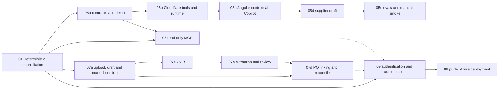

# Roadmap 05–09 — capability boundaries and dependencies

## Value-first product narrative

The current application can already **calculate and display** invoice-versus-PO differences. An LLM must not duplicate that arithmetic. The meaningful capabilities are: (1) ask questions across the **actual** persisted records and get sourced, useful actions; (2) eliminate manual document transcription through extraction and correction; (3) expose those read-only business capabilities to AI clients through MCP; (4) safely deploy with proper identity and tenant isolation.

## Delivery graph

Solid edges show required prerequisites; dotted edges show endpoints that Task 09 must cover if present. 07b/07c can be completed before 07d for the richer demo, but 07d requires only 07a and Task 04. MCP requires the 05a read service, not 05e live evaluation. Task 06 documentation/Bicep validation may be done earlier but **no public exposure** before 09.

## Current repo truths (checked at package creation)

- Default branch `master`.
- Existing API prefixes `/api/v1`, generated FastAPI `/openapi.json`, database migrations and read-only invoices API.
- Existing reconciliation `POST /api/v1/invoices/{invoice_id}/reconciliation` is deterministic, versioned and based on existing PO snapshots.
- API dates ISO, money decimal strings, statuses `needs_review`, `approved`, `processing`. Do not invent an invoice approval endpoint.
- Angular investigation screen's existing text is illustrative; new live AI content must have visible provenance and mode label.
- Data fixture `INV-2026-1042`: invoice gross 12,915.00; PO gross 12,300.00; gross delta 615.00 PLN; monitored unit price 820.00 vs 770.00 for 10 monitors.

## Canonical boundaries

**FastAPI business services** own invoice search/reconciliation and source-of-truth financial facts. **Copilot tools** only call approved services and return bounded typed responses; no arbitrary SQL. **LLM provider** selects tools and drafts bounded text, never performs authoritative calculations or writes. **MCP** wraps the same read-only services, not the LLM itself. **Document Intake** parses/uploads data into a **draft** that requires human correction/confirmation before invoice persistence. **Azure IaC** does not imply authentication is complete.

## Required demonstration storyline

1. Upload a previously unseen *fictional* PDF/scanned invoice (Task 07).
2. Extract structured fields; user corrects uncertain or missing fields.
3. A user confirms the corrected draft, creating a real invoice; comparison remains unavailable until a PO exists.
4. Link an independent stored PO or enter a fictional PO in local demo mode with validated item mappings, then explicitly run deterministic reconciliation. Existing invoice-owned snapshots remain historical evidence.
5. Copilot responds to a question and/or drafts supplier inquiry with verified evidence (Task 05).
6. External client discovers and executes a **read-only** InvoiceFlow MCP tool (Task 08).
7. CI verifies Angular/Vitest, Python/pytest, migrations, security-focused tests; no live model inference in CI.

## Cross-cutting Definition of Done

- Exact feature scope and expected file manifest in each subtask. No broad redesign or speculative frameworks.
- Unit and real PostgreSQL integration tests where persistence is changed; precise API errors and response contracts; OpenAPI schema stays authoritative.
- Human-readable errors for unavailable AI/OCR/provider; clear demo vs live labels; never state `AI-generated` for deterministic text.
- No leaks of credentials, uploads, document contents or untrusted prompt instructions in logs.
- Show actual test commands/results and diff. Never skip failed tests, auto-commit/push, or begin next task without user request.

## Upload flow clarification (current plan revision)

Task 07a is **scoped to implement** real PDF upload, persistent manual draft and confirmed invoice creation, with no OCR and no required PO. 07b adds OCR, 07c enriches the existing draft form with extracted suggestions, 07d links a *real* PO and invokes deterministic reconciliation. Existing `Review next invoice` must select an actual record from the API, never open Upload. See `tasks/backend/07-ai-document-intake.md` and `07a-upload-and-manual-confirm.md`.
